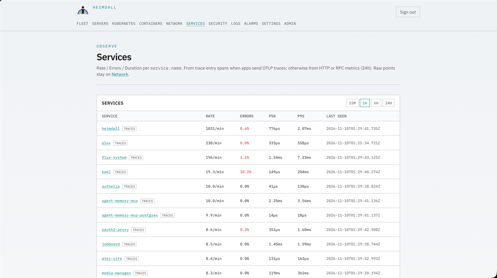
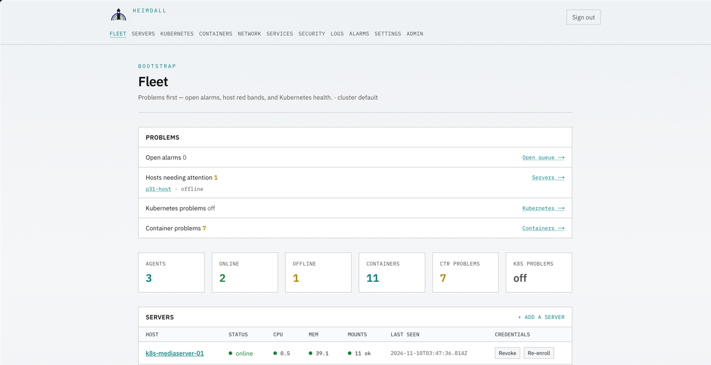
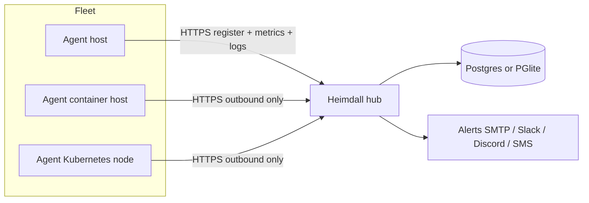

<picture>
  <source media="(prefers-color-scheme: dark)" srcset="assets/brand/heimdall-wordmark-dark.svg">
  <source media="(prefers-color-scheme: light)" srcset="assets/brand/heimdall-wordmark-light.svg">
  
</picture>

# Heimdall

[](https://github.com/ohallord/heimdall/actions/workflows/ci.yml)
[](LICENSE)

Self-hosted monitoring hub with outbound-only agents for host, container, and Kubernetes health. Agents register over HTTPS, push metrics and logs, and never open inbound ports on the fleet.

I built this to watch my own lab from one place without poking holes in every host firewall.

## Screenshots





## Architecture



Agents connect **out** to the hub. The hub stores samples, evaluates alert rules, and fans out notifications. Optional OpenTelemetry Collector sidecars send OTLP/HTTP JSON to `/v1/metrics` and `/v1/logs`.

## Quick start (Docker Compose)

Requires Docker with Compose v2. From a clone:

```bash
# Guided install (default dry-run; add --apply to write files)
./scripts/install.sh --non-interactive --mode compose --dry-run
./scripts/install.sh --non-interactive --mode compose --apply \
  --public-url http://127.0.0.1:43123 --port 43123 --storage postgres

cd deploy/docker
docker compose up --build
```

Open `http://127.0.0.1:43123` and finish the first-run wizard in the UI (admin user, alert channels, first agent token, MFA). The installer does **not** recreate those wizard steps.

Generated secrets land in `deploy/docker/.env.heimdall` (mode `0600`). The installer never prints them.

### Enroll an agent

After the wizard mints an agent token (or you set a bootstrap token in the hub env), on each host:

```bash
# Token via file — never pass secrets as CLI args
printf '%s' 'hdt_…' > /tmp/heimdall-token
chmod 600 /tmp/heimdall-token

./scripts/enroll-agent.sh --non-interactive --dry-run \
  --hub-url http://127.0.0.1:43123 \
  --token-file /tmp/heimdall-token

./scripts/enroll-agent.sh --non-interactive --apply \
  --hub-url http://127.0.0.1:43123 \
  --token-file /tmp/heimdall-token
```

`enroll-agent.sh` wraps `scripts/install-agent.sh` (systemd unit + `/etc/heimdall/agent.env`). From a released hub that serves `SHA256SUMS`, hosts can also use the one-line `scripts/install-host.sh` bootstrap (see [docs/deploy.md](docs/deploy.md)). For agent + host OTEL collector, use `scripts/install-baremetal.sh` after you mint an OTEL token under Settings → Integrations in the UI.

### Helm (values only)

```bash
./scripts/install.sh --non-interactive --mode helm --dry-run \
  --public-url https://heimdall.example.com --storage postgres
./scripts/install.sh --non-interactive --mode helm --apply \
  --public-url https://heimdall.example.com --storage postgres
helm upgrade --install heimdall deploy/helm/heimdall \
  -f deploy/helm/heimdall/values-heimdall-generated.yaml
```

The installer writes a values overlay and secret file. It does not talk to your cluster API unless you run `helm` yourself.

## Server configure (re-runnable)

Server-side knobs that belong in files / env (not the web UI):

```bash
./scripts/install.sh configure --non-interactive --apply \
  --mode compose \
  --public-url https://heimdall.example.com \
  --tls on \
  --storage postgres \
  --otel-collector on
```

| Knob | What it sets |
| --- | --- |
| `--public-url` / `--port` | `HEIMDALL_PUBLIC_URL`, compose publish port |
| `--tls on\|off` | `HEIMDALL_COOKIE_SECURE`, reminds you to terminate TLS at a reverse proxy |
| `--storage postgres\|pglite` | Compose Postgres service vs hub PGlite |
| `--otel-collector on\|off` | Whether to emit a collector compose snippet / baremetal hint |

Leave alert routing, MFA, OIDC, remotes, and token minting to the hub UI.

## Design notes

### Outbound-only agents

Each agent dials the hub. Host firewalls stay closed for Heimdall. That matches how I run labs where inbound SSH is already the exception.

### Security model

- Session auth with RBAC; admin MFA (TOTP + passkeys) in the wizard.
- Agent ingest uses hashed agent tokens (or a bootstrap token for smoke installs).
- OTEL ingest uses a separate `hdo_…` token from Settings → Integrations.
- Production fails closed when `HEIMDALL_SESSION_SECRET` is missing.
- Publish pipeline strips private paths, lab hostnames, and agent-control files before any public snapshot.

## Known limits

- OTLP: HTTP JSON metrics + logs only. No traces, no gRPC, no protobuf.
- Default agent image is distroless and does not bundle Trivy; host posture needs a host Trivy binary.
- Compose sample agent keeps Kubernetes scrape **off**. Helm chart defaults K8s scrape **on** for in-cluster agents.
- Public releases are squashed snapshot commits from the private repo; they are not a 1:1 private history mirror.
- Guided installer modes claimed here: **Compose** (file generation + documented `docker compose up`) and **Helm values overlay**. Full in-cluster verification is left to your `helm`/`kubectl` environment. Bare-metal **hub** install is not automated; bare-metal **agent** install is.

## Development

```bash
cd apps/hub && npm ci && npm test && npm run lint && npm run build
cd apps/agent && go test ./...
./scripts/handshake-smoke.sh
./scripts/tests/run.sh
```

More detail: [docs/development.md](docs/development.md), [docs/deploy.md](docs/deploy.md), [docs/architecture.md](docs/architecture.md).

## What I'd change

TODO(Dan): write this yourself.

## License

Apache License 2.0. See [LICENSE](LICENSE).
