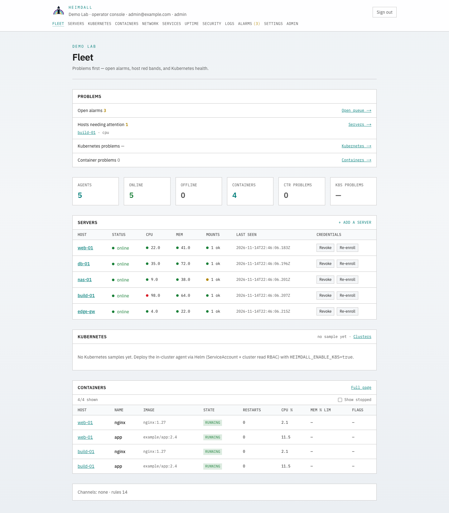
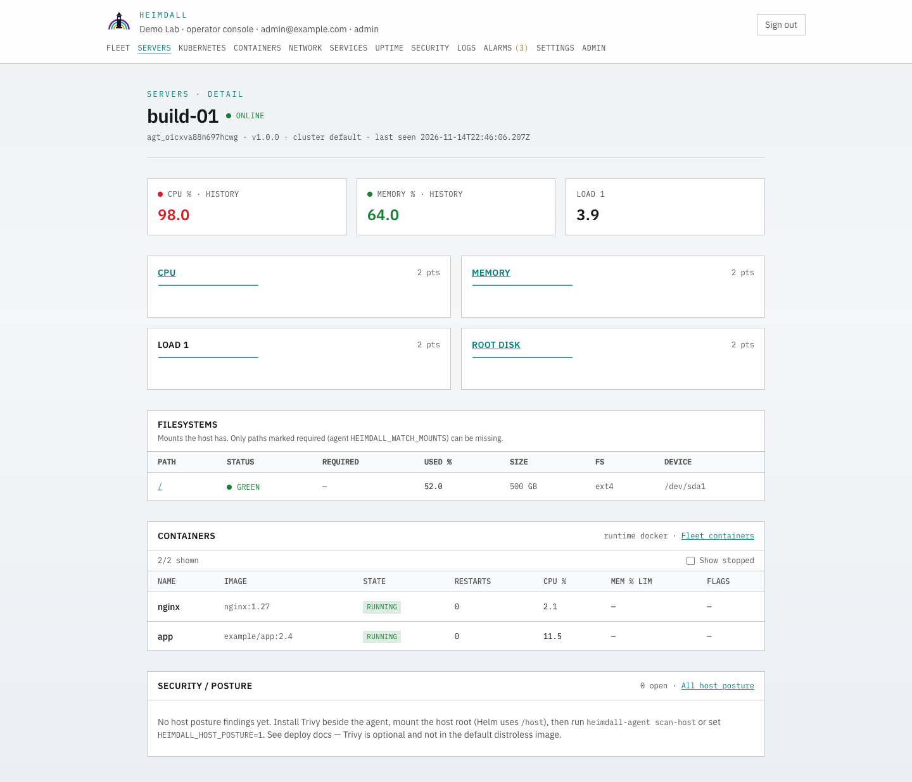
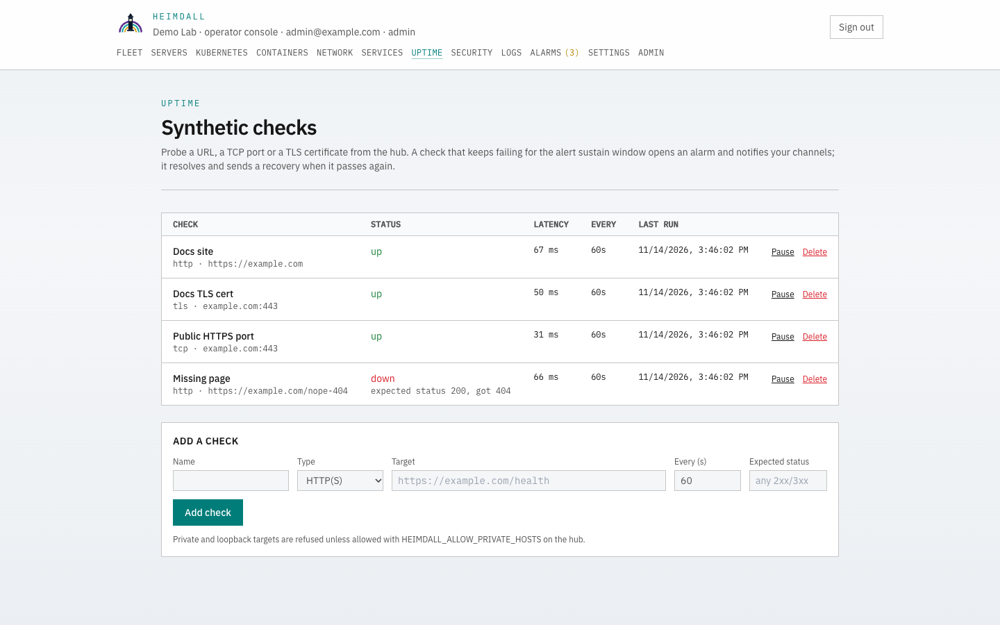
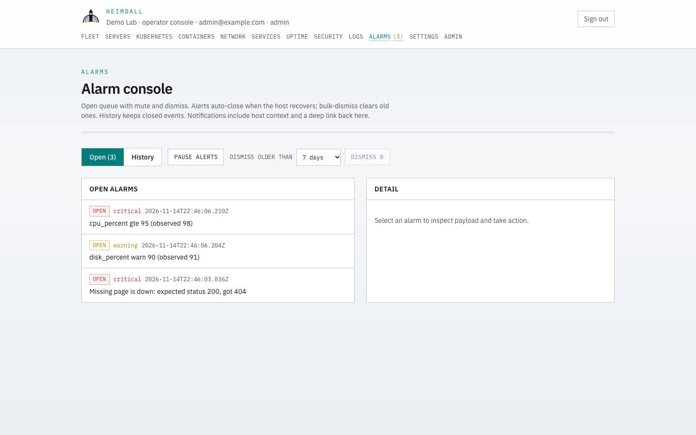
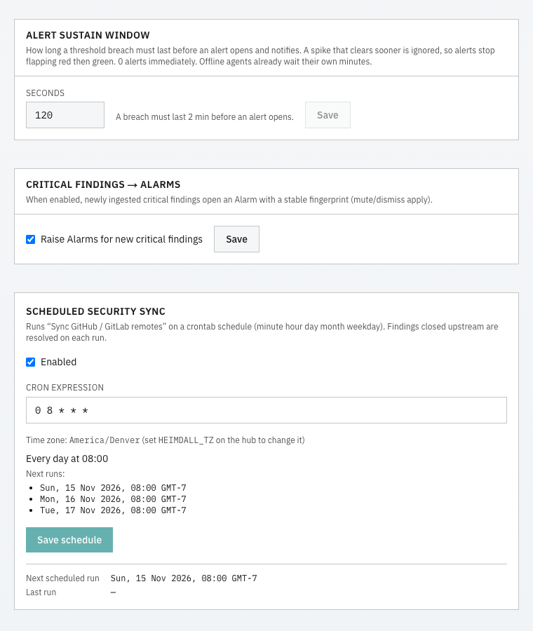
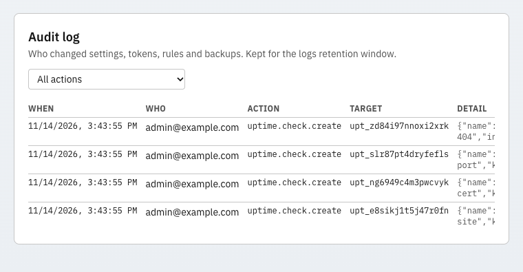

# Features tour

The console follows one rule: **problems first**. Each page shows what is wrong before it shows what is fine. Status dots are green (healthy), yellow (warning band) or red (alarm).

Navigation: **Fleet · Servers · Kubernetes · Containers · Network · Services · Uptime · Security · Logs · Alarms · Settings · Admin**

## Fleet (`/dashboard`)

The home page. It shows:

- **Servers**: every agent, with an online dot (online means a sample arrived in the last ~45 seconds) and the current CPU, memory and disk band. Click a host for its detail page.
- **Kubernetes**: a health summary of the **active cluster**: API reachability, nodes not Ready, pending and crash-looping pods, unhealthy deployments.
- Open problems ranked above healthy items.

### Host detail (`/dashboard/hosts/<agent>`)

- Current CPU, memory, load and per-mount disk usage, coloured by band
- **Metric history** charts for CPU, memory and disk (separate pages per metric), kept for the metrics retention window (default 60 days)
- **Containers** on this host, when a container runtime is present (hidden on hosts without one)
- **Security / Posture**: Trivy host findings for this machine
- Agent actions for operators and admins: **Revoke**, **Re-enroll**, **Delete**

## Kubernetes

Built from the in-cluster agent. Pod detail pages (`/dashboard/k8s/pods/<ns>/<name>`) show phase, restarts and reason. Clusters are managed under **Admin → Clusters** (`/dashboard/clusters`). There you register cluster IDs and choose which one the fleet summary shows.

## Containers (`/dashboard/containers`)

A fleet-wide table of Docker and Podman containers: state, restart count, OOM kills, exit code, CPU %, and memory as a percentage of the container's limit. Alarms fire for containers that **exit abnormally while being monitored**, OOM kills, restart loops (three or more restarts within the last 10 minutes, not the lifetime restart count), and memory at or above 90% of the limit.

## Network (`/dashboard/network`)

- **UniFi alarms**, grouped by category (or alarm name), then by device. See [UniFi setup](../unifi.md).
- **K8s exposure**: Services exposed as NodePort, LoadBalancer or ExternalIP, and NetworkPolicy coverage per namespace. See [network security](../network-security.md).
- **Recent OTel points**: raw OpenTelemetry metric samples.

## Services (`/dashboard/services`)

APM built from OpenTelemetry. Each `service.name` is listed with request rate, error rate, p50 and p95 latency (when it sends traces) and its metrics. Open a service to see its operations and recent traces. Click a trace for a **span waterfall** (`/dashboard/traces/<id>`). Traces come from app SDKs or, for apps you cannot instrument, from Grafana Beyla eBPF on Kubernetes. See [OpenTelemetry](../otel.md).

## Security (`/dashboard/security`)

One list of findings from every source, with severity tiles at the top. Filter by source:

| Source | Where findings come from |
| --- | --- |
| `trivy` | `heimdall-agent scan-image` (container images) |
| `host_posture` | `heimdall-agent scan-host` or scheduled scans (OS packages and misconfigurations) |
| `osv` | OSV-Scanner JSON reports posted to `/api/v1/security/scan` |
| `github` | Dependabot and org security advisories, from connected GitHub orgs |
| `gitlab` | Vulnerabilities from connected GitLab projects |
| `runtime` | Falco events through the runtime webhook |

Open a finding for details and to change its status (resolve). When **Critical findings → alarms** is on (Settings), new critical findings also open an alarm.

**Remotes** (`/dashboard/remotes`) lists the GitHub organizations and GitLab projects to sync. You can add as many as you need. Large accounts are synced page by page (up to 20 pages of 100 per list); if a list is cut off the sync reports a `truncated` warning. See the [security sync runbook](../runbooks/security-sync.md).

## Uptime (`/dashboard/uptime`)

Synthetic checks run from the hub itself (no agent needed):

| Type | Target | Down when |
| --- | --- | --- |
| HTTP(S) | a URL | the status is not the expected one (default: any 2xx/3xx), or it times out |
| TCP | `host:port` | the port does not accept a connection in time |
| TLS | `host` or `host:port` (default 443) | the handshake fails (expired, self-signed, wrong name) or the certificate has fewer than N days left (default 14) |

Each check has an interval (30 s to 24 h, default 60 s) and a timeout. The page lists the last status, latency and error. **Operator or admin** can add, pause and delete checks (`alerts:write`); everyone signed in can read them.

A check is **down** once it has failed for the alert sustain window (Settings, default 120 s; `0` = first failure) and at least two probes in a row. That opens a critical alarm in **Alarms** and notifies your channels. When it passes again the alarm resolves and a recovery message is sent. Private, loopback and link-local targets are refused unless allowed with `HEIMDALL_ALLOW_PRIVATE_HOSTS`. API: `GET/POST/PATCH/DELETE /api/v1/uptime`. Details: [uptime runbook](../runbooks/uptime-checks.md).

## Logs (`/dashboard/logs`)

Search log lines from agent file tailing and OTel log pipelines. Filter by text, rule, host, or "matches only". Every line runs through the built-in threat rules:

| Rule | Severity | Alerts? |
| --- | --- | --- |
| Failed SSH password / invalid user | medium | yes |
| Suspicious sudo (auth failure, not in sudoers) | high | yes |
| sudo command (successful `COMMAND=`) | low | no, tagged for audit only |
| Reverse shell indicator (`/dev/tcp`, `nc -e`, …) | critical | yes |
| Crypto miner indicator | critical | yes |
| Webshell or C2 download indicator | critical | yes |
| Privilege escalation indicator | high | yes |

Heimdall tokens (`hdt_`, `hda_`, `hdb_`, `hdo_`, `hdu_`, `hdr_`) are **redacted** from log lines before they are stored. Other secrets that appear in your logs (passwords, API keys) are stored as-is, so choose which files and units you ship accordingly.

## Alarms (`/dashboard/alerts`)

The alarm console: open, muted, recovered and dismissed alerts from metric rules, log rules, UniFi and critical findings.

- **Mute** an alarm for 15 minutes, 30 minutes, 1 hour or 4 hours. The mute applies to that alert's identity (same rule, host and metric), so repeats stay quiet.
- **Dismiss** one alarm, or many at once.
- **Recovered** badge: the condition cleared on its own. If the original alarm notified someone, a "Recovered" notice is sent too.
- **Pause all notifications**: a global kill switch for outbound email, Slack, Discord, SMS, ntfy, Pushover, Telegram and PagerDuty. While paused, metric and log rules also **stop opening new alarms**. Existing alarms still auto-recover.
- **Sustain window** (Settings → Alert sustain window): a threshold breach must last this many seconds (default 120, `0` = immediately) before an alert opens or notifies. A spike that clears sooner never alerts and never sends a "recovered" message. A healthy sample restarts the clock. Offline agents use their own minutes instead. Each host rule (CPU, memory, disk) can override the window in Settings → Host thresholds (**Sustain (s)**, 0–3600; blank = the org window). API: `PATCH /api/v1/alerts/rules/:id` with `sustainSeconds` (`null` clears the override).
- **Alert history** with deep links. Notification messages link straight to the alarm.
- The read-only MCP `heimdall_alerts` tool reports open alarms for the organization that has an admin (or `HEIMDALL_ORG_ID` when that is set). It includes a count per rule and can filter by rule name or host, so one long-running alarm does not hide the others.

## Settings (`/dashboard/settings`)

| Section | Who | What |
| --- | --- | --- |
| Notification preferences | Everyone, for themselves | Which channels you want, your SMS number, quiet hours and timezone |
| Host thresholds | Operator, admin | Warn and alarm levels, and an optional per-rule sustain window, for CPU, memory and disk (defaults 85/95, 90/98, 90/98) |
| Metric history retention | Operator, admin | Metrics and logs (30–365 days, default 60; closed alarms follow the logs window), traces (1–60 days, default 7) |
| Critical findings → alarms | Operator, admin | Open an alarm for new critical security findings |
| Agents | Admin (tokens: operator too) | **+ Add a server**, enrollment tokens (expiry, max uses, replace, revoke), bootstrap token mode |
| Integrations | Admin | Rotate OTel (`hdo_`), UniFi (`hdu_`) and runtime (`hdr_`) tokens; shows endpoint URLs |

## Admin (`/dashboard/admin`)

- **Identity**: add OIDC SSO providers (issuer, client ID and secret, scopes).
- **Backup / restore**: export the organization's configuration as JSON (secrets redacted unless you ask for them) and restore it.
- **Audit log**: who changed what (settings, alert rules, enrollment and bootstrap tokens, OIDC, backup export/restore, security remotes, alert channels), filterable by action. Entries are kept for the logs retention window. API: `GET /api/v1/admin/audit?action=&limit=&cursor=` (admin only).
- **Clusters** link.

## Not in the console (yet)

- Inviting local users or changing a user's role
- Editing alert channels after setup, including ntfy, Pushover, Telegram and PagerDuty (use the API; see [how-to](how-to.md#configure-alert-channels))
- A "send test alert" button (use `POST /api/v1/alerts/test`)
- Managing your own MFA factors after setup, including passkeys (API only; see [how-to](how-to.md#enroll-mfa))
- Custom log rules or custom metric rules (built-in rules can be tuned and disabled)
